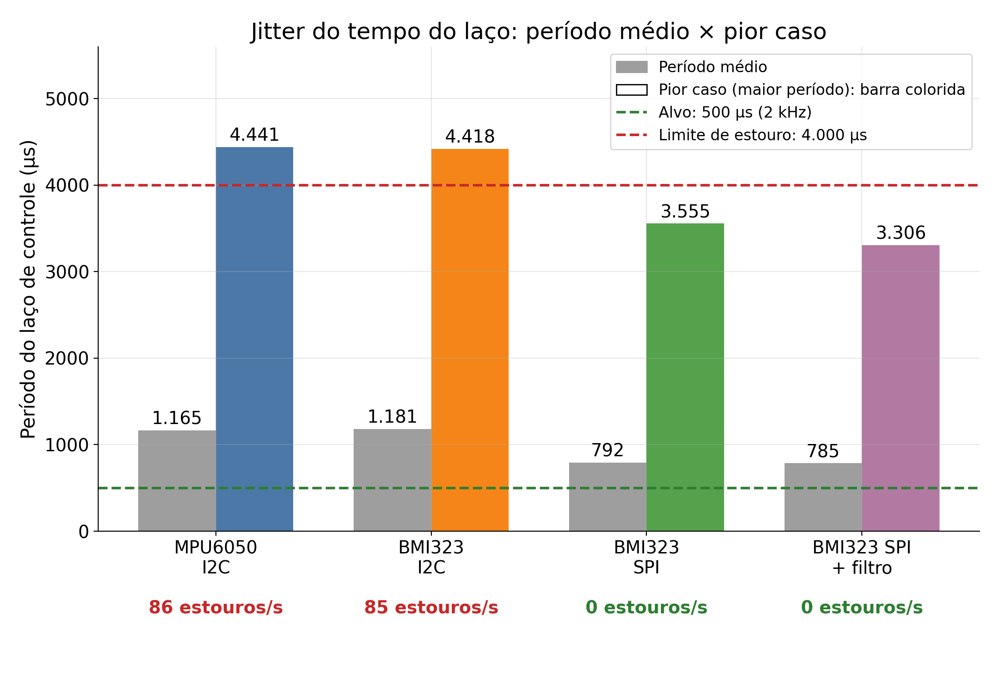

# Projeto-IC

Repositório da Iniciação Científica (IFSP – Presidente Epitácio):
**Desenvolvimento de uma Aplicação Web do Controlador PID para Estabilização de um Motor Brushless via ESP32.**

A bancada é uma balança (viga) com 2 motores brushless, controlada por um ESP32 com PID em cascata, lendo a inclinação por sensor inercial (MPU6050 ou BMI323). O PID final, encontrado por Ziegler-Nichols e refinamento por testes, é **Kp 0,31 · Ki 0,4 · Kd 0,14**.

## Organização

| Pasta | Conteúdo |
|---|---|
| [`proposta/`](proposta) | Proposta de IC (PDF do SUAP) |
| [`codigos_estabilizacao_dRehmFlight/`](codigos_estabilizacao_dRehmFlight) | Códigos de estabilização **prontos para rodar** (base dRehmFlight): MPU6050 I2C, BMI323 I2C, BMI323 SPI e BMI323 com filtro interno, todos com o PID final |
| [`buscar_PID/`](buscar_PID) | Como o PID foi encontrado (Ziegler-Nichols e refinamento), com o README do processo e **todos os CSVs** dos testes |
| [`comparativos/`](comparativos) | Comparativo final dos quatro sensores (jitter e trepidação): script em Python, CSVs dos testes de 1 min parado + 3 min armado e gráficos |
| [`testes_componentes/`](testes_componentes) | Testes isolados de cada componente: MPU6050 (I2C), BMI323 (SPI e I2C), micro do GY-601N1 (UART) e ESCs/motores (PWM) |

## Para que serve `testes_componentes/`

Antes de usar um componente no firmware principal, valide-o sozinho: se os fios estão certos, se o protocolo responde e se o sinal é bom. Se você for usar o **MPU6050**, o **BMI323 / GY-601N1** ou os **ESCs e motores**, é nessa pasta que está o teste correspondente, com o passo a passo de ligação e execução.

Veja o [README da pasta](testes_componentes/README.md) para a visão geral de cada teste.

## Resultados do comparativo

Com o mesmo PID e o mesmo acelerador (1150 µs), 1 minuto parado e 3 minutos armado por configuração. Detalhes, definições e gráficos no [README de `comparativos/`](comparativos/README.md).

| Métrica | MPU6050 I2C | BMI323 I2C | BMI323 SPI | BMI323 SPI + filtro |
|---|---|---|---|---|
| Roll: desvio padrão (°) | 0,194 | 0,186 | 0,156 | 0,185 |
| Período médio do laço (µs, alvo 500) | 1165 | 1181 | 792 | 785 |
| Estouros por segundo (≥ 4000 µs) | 86 | 85 | 0 | 0 |
| Trepidação com motores ligados (mg, 2–40 Hz) | 42,9 | 75,4 | 89,3 | não registrada |

Uma corrida por configuração; os valores servem de comparação, não de medida definitiva.
