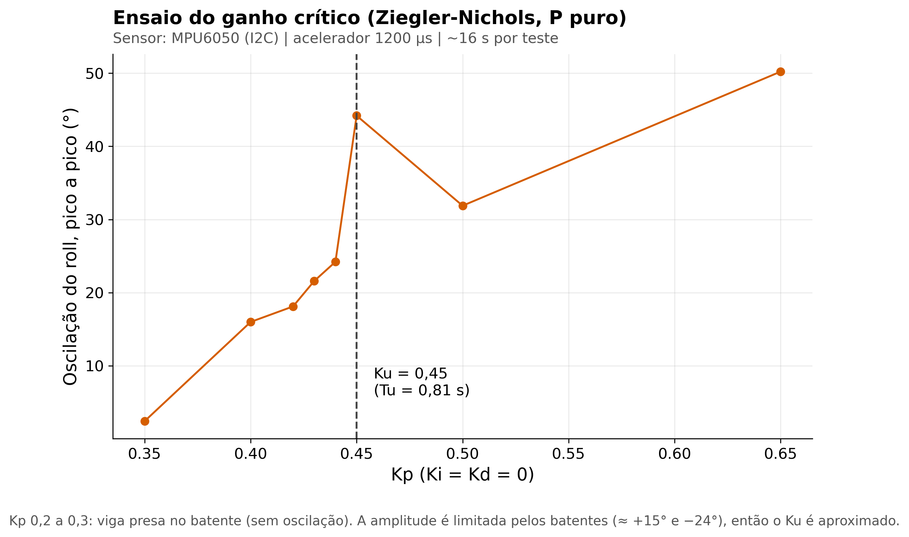
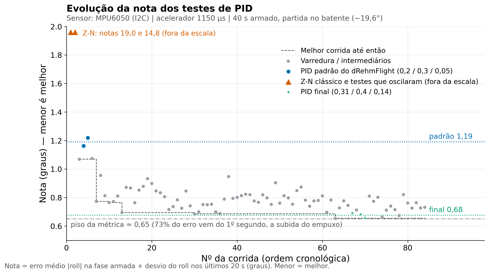
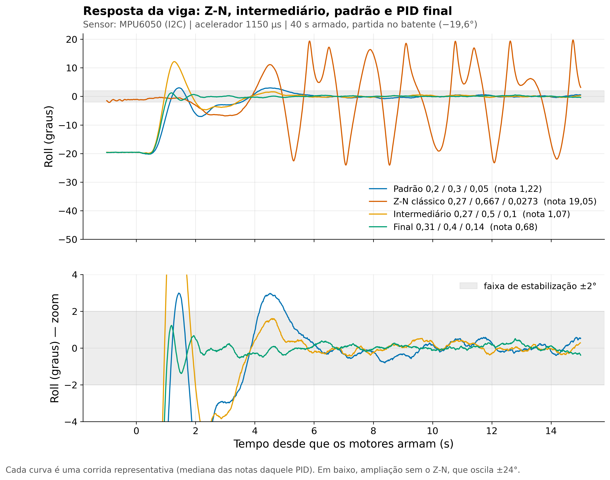
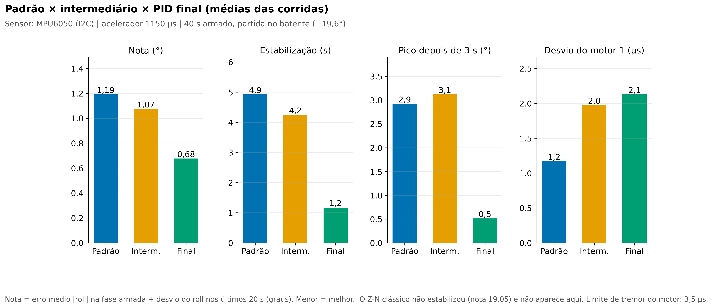

# Busca do PID

Como cheguei ao PID final **Kp 0,31 · Ki 0,4 · Kd 0,14** da viga de 2 motores (ESP32 + dRehmFlight, sensor MPU6050 por I2C, eixo roll). O ponto de partida foi o método de **Ziegler-Nichols (Z-N)**; como o Z-N clássico não estabilizou a viga, refinei o PID **por testes**, um parâmetro por vez, com uma nota e limites definidos. Este documento reúne o processo inteiro e os dados brutos de todos os testes válidos.

## Conteúdo da pasta

| Item | O que é |
|---|---|
| [`dados/1_ziegler_nichols_thr1200/`](dados/1_ziegler_nichols_thr1200) | 15 CSVs da fase Ziegler-Nichols: a varredura de Kp com P puro (Ki = Kd = 0), usada para achar o ganho crítico, e os dois PIDs calculados pela tabela. Acelerador de 1200 µs, ~16 s por teste (18/11/2026) |
| [`dados/2_refinamento_thr1150/`](dados/2_refinamento_thr1150) | 84 CSVs da fase de refinamento (58 combinações de ganhos). Cada corrida tem um CSV com os dados e um `_stats.csv` com o tempo do laço por segundo. Acelerador de 1150 µs, 40 s armado (22/11/2026) |
| [`tabela_completa/`](tabela_completa/README.md) | Tabela com as 58 combinações de ganhos testadas e seus resultados |
| [`graficos/`](graficos) | Gráficos gerados a partir desses CSVs |
| [`resumo_pid_mpu.csv`](resumo_pid_mpu.csv) | Uma linha por combinação de ganhos: nota média, mínima e máxima, assentamento, pico, desvio do motor e status |
| [`ferramentas/controle_testes.py`](ferramentas/controle_testes.py) | Ponte USB entre o computador e o ESP32: envia os comandos e grava os dados de cada teste em CSV |
| [`ferramentas/rodar_teste_pid.py`](ferramentas/rodar_teste_pid.py) | Executa um teste completo com um PID (ajusta os ganhos, arma, sobe o acelerador, mantém, desarma) e mede o resultado |

Os CSVs estão **sem alteração**, exatamente como saíram da ponte serial. Deixei de fora apenas corridas inválidas (viga travada, queda de comunicação, teste interrompido) e testes de outras etapas.

## 1. Resumo

| | Kp | Ki | Kd | Origem |
|---|---|---|---|---|
| Padrão do dRehmFlight | 0,2 | 0,3 | 0,05 | Valores padrão do firmware (ajuste empírico do autor) |
| Z-N clássico (calculado) | 0,270 | 0,667 | 0,0273 | Ku = 0,45, Tu = 0,81 s medidos na minha viga |
| **PID final escolhido** | **0,31** | **0,4** | **0,14** | Z-N como ponto de partida + refinamento por testes |

O PID final tem **nota 0,68** (média de 3 corridas), contra **1,19** do padrão e **19,05** do Z-N clássico (que não estabilizou). Assenta em ~1,2 s (o padrão em ~5 s), com pico depois de 3 s de 0,5° e sem tremor dos motores (desvio do motor 1 de 2,1 µs, abaixo do limite de 3,5 µs).

## 2. Fase 1: Ziegler-Nichols

### De onde vêm os valores do dRehmFlight
Os ganhos do roll em modo ângulo do dRehmFlight (Kp 0,2 / Ki 0,3 / Kd 0,05) são **valores padrão escolhidos pelo autor (Nick Rehm) por ajuste manual** para um quadricóptero de cerca de 1 kg com hélices de 7". Não foram calculados por Ziegler-Nichols nem por modelo. A própria documentação do projeto manda ajustar à mão: reduzir o P, subir o D em passos de ~20%, aumentar o P em ~15% e deixar o I por último.

No firmware o cálculo é `PID = 0,01 · (Kp·erro + Ki·∫erro·dt − Kd·giro)`, e o mixer dá `motor1 = acelerador + PID`, `motor2 = acelerador − PID`. Com Kp 0,2, cada grau de erro vale ~2 µs de diferença por motor.

### O que o Z-N prescreve
O método de malha fechada (ganho crítico): com Ki = Kd = 0, aumenta-se o Kp até a viga oscilar de forma sustentada. Esse Kp é o **Ku** e o período da oscilação é o **Tu**. A tabela clássica dá Kp = 0,6·Ku, Ti = Tu/2 e Td = Tu/8, e no firmware (forma paralela) Ki = Kp/Ti e Kd = Kp·Td.

Medi (P puro, acelerador de 1200 µs, ~16 s por teste): com Kp 0,40 a oscilação amortece; de 0,42 a 0,44 ela é sustentada mas só de um lado do zero; com **Kp 0,45** ela é sustentada e passa pelos dois lados do zero (o critério do método). Adotei **Ku = 0,45** e **Tu = 0,81 s** (ensaios vizinhos deram 0,86 a 0,96 s). Os detalhes desses ensaios estão logo abaixo e os CSVs em [`dados/1_ziegler_nichols_thr1200/`](dados/1_ziegler_nichols_thr1200).

| Passo | Conta | Resultado |
|---|---|---|
| Kp | 0,6 × 0,45 | **0,270** |
| Ti | 0,81 / 2 | 0,405 s |
| Ki | 0,270 / 0,405 | **0,667** |
| Td | 0,81 / 8 | 0,101 s |
| Kd | 0,270 × 0,101 | **0,0273** |

### Ensaios de ganho crítico (P puro, acelerador fixo em 1200 µs, ~16 s cada)
Resultados medidos no roll, com os motores ligados durante toda a corrida:

| Kp | Comportamento | Variação do roll (pico a pico) | Período |
|---|---|---|---|
| 0,2 | viga encostada no batente (−22°) por 6 a 10 s, depois sai | — | — |
| 0,3 | encostada no batente (−21°) | — | — |
| 0,35 | encostada no batente (−20°) | ~2° | — |
| 0,40 | oscilação pequena que **amortece** | 16° → 6° | — |
| 0,42 | oscilação **sustentada** (só do lado negativo, ~−13°) | ~18° | 0,96 s |
| 0,43 | oscilação **sustentada** | ~22° | 0,91 s |
| 0,44 | oscilação **sustentada** | ~24° | 0,90 s |
| **0,45** | oscilação sustentada, **passando pelos dois lados do zero** | ~44° | **0,81 s** |
| 0,50 | oscilação sustentada regular | ~32° | 0,86 s |
| 0,65 | oscilação sustentada maior | ~50° | 0,91 s |

Observações importantes:
- Sem o termo integral, o peso desigual da viga (o motor 2 precisa de ~100 µs a mais que o motor 1 para ficar nivelada) faz as oscilações de Kp baixo girarem em torno de um valor deslocado (~−12°) e não de 0°. A oscilação passa pelos dois lados do zero a partir de **~0,45**.
- Com Kp 0,2 a 0,35 o P puro não gera diferença suficiente entre os motores para sair do batente. Isso é falta de ganho para vencer o peso, e não oscilação.
- A amplitude é limitada pelos batentes mecânicos da viga (≈ +15° e −24°), o que torna o Ku uma estimativa aproximada.

### Valores adotados
- **Ku = 0,45**: é o primeiro Kp em que a oscilação é sustentada **e passa pelos dois lados do zero**, que é a definição do método (oscilação em torno do alvo). Com 0,42 a 0,44 a oscilação também se mantém, mas só de um lado, deslocada pelo peso desigual da viga (não há integral). Com 0,40 ela amortece.
- **Tu = 0,81 s**: período medido no próprio ensaio com Ku (0,45). Os ensaios vizinhos deram 0,86 s (Kp 0,50), 0,90 s (0,44) e 0,96 s (0,42), então o Tu fica entre 0,8 e 1,0 s e usei o valor medido em Ku.

### Cálculo (Z-N clássico)

As fórmulas clássicas são: Kp = 0,6·Ku; tempo de integral Ti = Tu/2; tempo de derivada Td = Tu/8. No firmware os ganhos estão na **forma paralela**, então: Ki = Kp/Ti e Kd = Kp·Td (o Kd multiplica o giro, que é a derivada do ângulo).

| Passo | Conta | Resultado |
|---|---|---|
| Kp | 0,6 × 0,45 | **0,270** |
| Ti | 0,81 / 2 | 0,405 s |
| Ki | 0,270 / 0,405 | **0,667** |
| Td | 0,81 / 8 | 0,101 s |
| Kd | 0,270 × 0,101 | **0,0273** |

Resultado do Z-N clássico: **Kp ≈ 0,27 ; Ki ≈ 0,67 ; Kd ≈ 0,027** (equivale às fórmulas diretas Ki = 1,2·Ku/Tu e Kd = 0,075·Ku·Tu).

### Variantes mais suaves (mesmo Ku e Tu)
O Z-N clássico busca uma queda de um quarto da amplitude por ciclo, o que é agressivo e dá overshoot. Há variantes da mesma tabela com menos overshoot:

| Variante | Kp | Ti | Td | Ki = Kp/Ti | Kd = Kp·Td |
|---|---|---|---|---|---|
| Clássico | 0,6·Ku = **0,270** | Tu/2 = 0,405 | Tu/8 = 0,101 | **0,667** | **0,0273** |
| Algum overshoot | 0,33·Ku = **0,149** | Tu/2 = 0,405 | Tu/3 = 0,27 | **0,367** | **0,0401** |
| Sem overshoot | 0,2·Ku = **0,090** | Tu/2 = 0,405 | Tu/3 = 0,27 | **0,222** | **0,0243** |
| *Padrão dRehmFlight (referência)* | *0,20* | — | — | *0,30* | *0,05* |

### O que aconteceu ao aplicar o Z-N
O Z-N clássico (0,27 / 0,667 / 0,0273) **não estabilizou**: a viga oscilou de batente a batente (±20° a ±24°), tanto com acelerador de 1200 µs (±19°) quanto de 1150 µs (nota 19,05, só 11% do tempo dentro de ±1°). Um segundo teste com Ki 0,5 e Kd baixo (0,0273) também oscilou.

Isso é esperado na literatura: as regras do Z-N são **agressivas para processos que se comportam como integradores** (Tyreus e Luyben propuseram ajustes menos agressivos, com Ti = 2,2·Tu), e a viga é um sistema que integra duas vezes (torque, giro, ângulo) com batentes mecânicos. O meu Ku também foi estimado com a oscilação limitada pelos batentes. As causas concretas aqui foram **Ki alto (windup nos batentes) e Kd baixo (pouco amortecimento)**.

## 3. Fase 2: refinamento do PID
- **Condições iguais em todos os testes:** acelerador de 1150 µs constantes, 40 s armado, viga solta e sem tocar, partindo do batente (~−19,6°); o PID é enviado ao vivo (`#P/#I/#D`).
- **Um parâmetro por vez**, em passos pequenos, comparando com o melhor anterior; o que melhora fica, o que não melhora volta.
- **Ordem de ajuste:** D, depois P, depois I, como nos guias de multicópteros (ArduPilot, PX4).
- **Nota (menor é melhor)** = erro médio |roll| em toda a fase armada (inclui o transitório) + desvio do roll nos últimos 20 s, em graus.
- **Limites (reprova):** tremor do motor (desvio do motor 1 > 3,5 µs nos últimos 20 s), giro > 3 dps, |roll| > 10° depois de 8 s, assentamento (|roll| ≤ 2°) > 8 s.
- **Decisão:** a nota decide; só quando a nota é igual (duas casas decimais) vale o de **menor Kp**. Só PIDs com 2 ou mais corridas podem ser o escolhido.
- **Ruído:** o mesmo PID rodado 3 vezes deu notas entre 0,69 e 0,87, então diferenças de ~0,1 entre PIDs de uma corrida só não são significativas.

### Tabela completa

As 58 combinações testadas, com nota, assentamento, pico e status de cada uma, estão na [tabela completa](tabela_completa/README.md).

### Por que as notas ficaram assim
- **O primeiro segundo pesa ~73% do erro médio.** Nesse trecho a viga ainda está no batente enquanto o empuxo sobe; isso é a subida do motor, e não o PID. Por isso o piso desta métrica fica em ~0,65 e a nota 0,5 não é alcançável só com ganhos. As melhores corridas ficaram em 0,65 a 0,66, praticamente no piso.
- **Ki foi o parâmetro que mais mudou o resultado.** Com Ki 0,5 a viga passa +8° a +12° do nível ao sair do batente e a nota fica em ~1,07. Com Ki 0,4 passa só ~1,5° e a nota cai para ~0,78. Ki 0,3 ou 0,45 já pioram (0,96 e 0,92). O Ki alto acumula erro enquanto a viga está encostada (windup) e depois joga a viga para o outro lado.
- **Kd mais alto acabou com a oscilação do Z-N.** De 0,027 para 0,1 a viga parou de bater de lado a lado. Abaixo de 0,11 piora de novo (Kd 0,09: nota 0,95, pico 2,7°).
- **Kp e Kd altos juntos aceleram a saída do batente** (o erro grande vira mais diferença de µs no motor 2). Por isso o final tem Kp 0,31 e Kd 0,14, acima dos vizinhos. Mas acima de **Kp 0,33 ou Kd 0,15** aparece um degrau (assentamento de ~3 s e pico de ~2°).
- **Última varredura (14 testes em volta do final):** Ki de 0,36 a 0,46, Kd de 0,13 a 0,145 e Kp de 0,30 a 0,315 deram notas de 0,66 a 0,82, e nenhum superou o final com confirmação (Ki 0,44: 0,66 e 0,74; Kd 0,145: 0,67 / 0,73 / 0,73). É um **patamar plano**: os ganhos já estão no piso da métrica e as diferenças restantes ficam dentro do ruído.
- **O padrão (nota 1,19)** é estável e o mais quieto nos motores (1,2 µs), mas assenta em ~5 s e tem pico de 2,9° depois de 3 s.

### Justificativa do PID escolhido
O **PID final (Kp 0,31 / Ki 0,4 / Kd 0,14)** é o de menor nota entre os PIDs confirmados com 3 corridas (0,69 / 0,68 / 0,66, média 0,68), com assentamento de ~1 s e pico de 0,4° a 0,6°, sem tremor. Comparado com o Z-N clássico:

| Parâmetro | Z-N clássico | Final | Relação |
|---|---|---|---|
| Kp | 0,270 (0,6·Ku) | 0,31 (≈0,69·Ku) | ligeiramente maior |
| Ti = Kp/Ki | 0,40 s (Tu/2) | 0,77 s (≈0,96·Tu) | **~1,9× mais lento** (integral bem mais fraco) |
| Td = Kd/Kp | 0,10 s (Tu/8) | 0,45 s (≈0,56·Tu) | **~4,5× maior** (muito mais amortecimento) |

Ou seja, o Z-N deu a **ordem de grandeza do Kp**, mas pedia um integral forte e pouco derivativo, o oposto do que a viga precisou. É o comportamento previsto para um processo integrador (menos integral, mais derivativo). A justificativa técnica é: **Z-N como ponto de partida, e o refinamento sistemático, com métrica e limites definidos, deu um PID quantitativamente melhor que o padrão do firmware e que o Z-N puro**.

## 4. Como aplicar nos firmwares
Os ganhos ficam nas variáveis `Kp_roll_angle`, `Ki_roll_angle` e `Kd_roll_angle` (e as de pitch, se usar) nos três `.ino`. Ao vivo, pelo terminal da ponte: `#P0,31`, `#I0,4`, `#D0,14` (valem até reiniciar o ESP32).

## 5. Como os CSVs foram gerados

1. O ESP32 roda o firmware com o MPU6050 e o log rápido (~100 Hz) ligado.
2. `ferramentas/controle_testes.py` abre a porta serial (COM4, 500000 baud) e faz uma **ponte por arquivos**: lê comandos de `controle/comandos.txt` e grava as respostas em `controle/saida.txt`. O comando `!novo <nome>` abre um CSV novo em `dados/` e `!fim` o fecha.
3. `ferramentas/rodar_teste_pid.py Kp Ki Kd [tempo] [acelerador]` executa um teste: ajusta o limite e os ganhos ao vivo (`#L`, `#P`, `#I`, `#D`), abre o CSV, arma (`a`), sobe o acelerador (`#T1150`) até o valor do teste, mantém pelo tempo pedido, desarma (`d`) e fecha o arquivo. Se o |roll| passar de 38°, o teste é abortado.
4. Cada CSV traz: `tempo_s`, `roll_graus`, `pitch_graus`, giros, saídas do PID, `motor1_us`, `motor2_us`, `Kp`, `Ki`, `Kd`, `acelerador_us`, acelerações e `micros`. O nome do arquivo tem os ganhos e o acelerador: `zn_P<Kp>_I<Ki>_D<Kd>_thr<acelerador>_<data>_<hora>.csv`. O `_stats.csv` traz os contadores do laço por segundo.
5. Formato: separador `;`, decimal com vírgula, UTF-8.
6. Segurança: fiquei ao lado da viga em todos os testes, e o ESP32 corta o acelerador se a inclinação passar de 45°.

### Gráficos

Os demais estão em [`graficos/`](graficos): tempo de estabilização (`fig2`), sensibilidade a cada ganho (`fig4`) e nota × assentamento (`fig5`).

## 6. Limitações
- Um só eixo (roll), acelerador de 1150 µs, viga específica, sensor **MPU6050**. Com os outros sensores (BMI323 SPI e com filtro) a latência e o ruído mudam, e o PID não está otimizado para eles; no [comparativo final](../comparativos/README.md) o PID é o mesmo nos quatro.
- A nota depende da partida no batente. A resposta a perturbações (batida de mão) e o anti-windup (limitar o integral no firmware) não foram testados nesta etapa.
- O Ku foi estimado com a oscilação limitada pelos batentes, então é aproximado.
- O relógio do ESP32 (`micros()`, 32 bits) dá a volta a cada ~71,6 min ligado; a análise corrige isso.
- A variação entre corridas iguais é de até ~0,2 na nota.

## Referências
- Ziegler e Nichols (1942), método de oscilação sustentada; resumo: https://en.wikipedia.org/wiki/Ziegler%E2%80%93Nichols_method
- Shamsuzzoha e Skogestad, *The setpoint overshoot method* (Z-N agressivo para processos integradores; Tyreus-Luyben): https://skoge.folk.ntnu.no/publications/2010/shamsuzzoha_pid_jpc/jpc-article.pdf
- Process Control Modeling, Z-N e Tyreus-Luyben (O'Reilly): https://www.oreilly.com/library/view/process-control-modeling/0133536408/0133536408_art06lev1sec4.html
- Åström e Hägglund, *PID Control* (filtro no D, windup): https://www.scribd.com/doc/87290996/astrom-ch6
- Windup e anti-windup (MathWorks): https://www.mathworks.com/help/simulink/slref/anti-windup-control-using-a-pid-controller.html
- Ordem de ajuste em multicópteros (PX4): https://docs.px4.io/main/en/config_mc/pid_tuning_guide_multicopter
- Ajuste de PID de drones (Oscar Liang): https://oscarliang.com/pid
- dRehmFlight (Nick Rehm), documentação e código do firmware.
