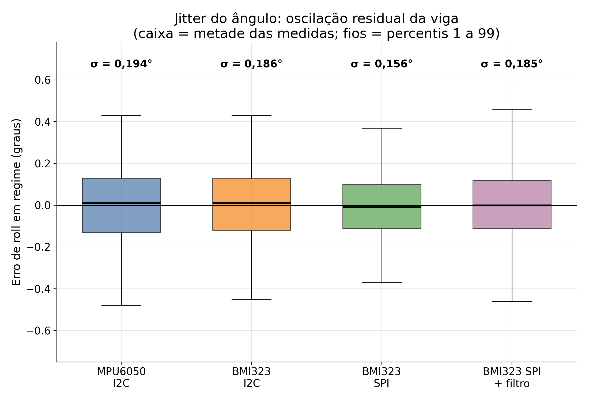
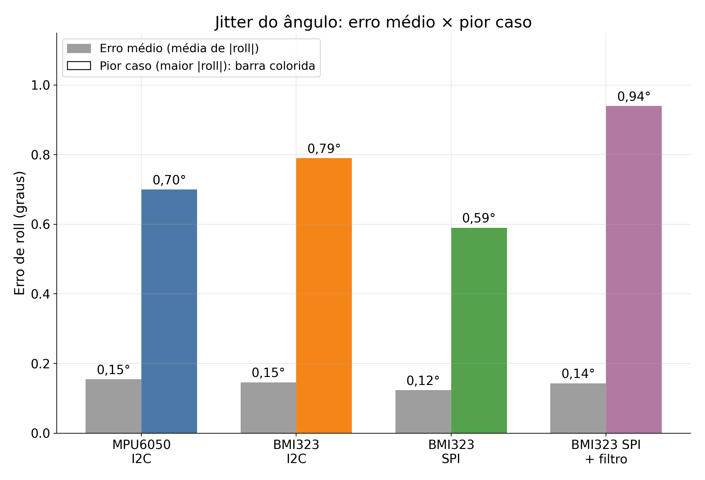
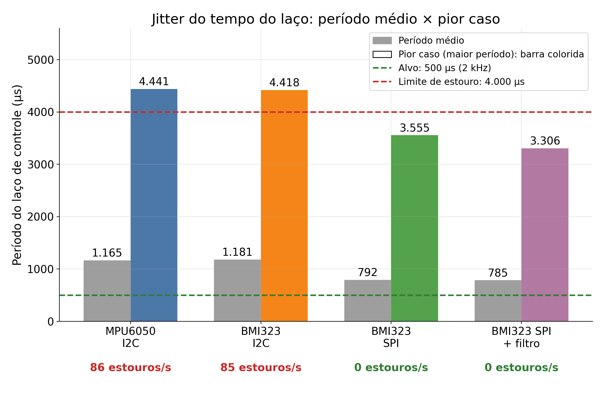
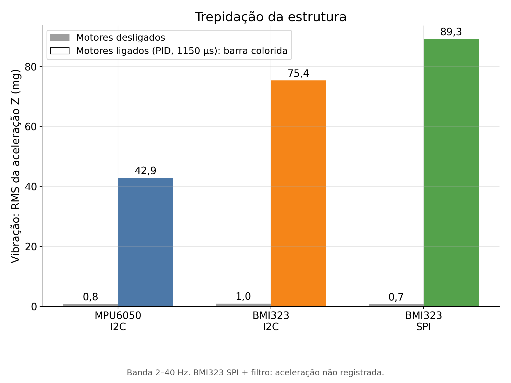

# Comparativo final dos sensores

Compara, na mesma viga de 2 motores, com o **mesmo PID final (Kp 0,31 · Ki 0,4 · Kd 0,14)** e o mesmo acelerador, quatro configurações de sensor e comunicação:

| Config. | Código | Sensor | Comunicação |
|---|---|---|---|
| 1 | [`Codigo_MPU6050_I2C`](../codigos_estabilizacao_dRehmFlight/Codigo_MPU6050_I2C) | MPU6050 | I2C 400 kHz |
| 2 | [`Codigo_BMI323_I2C`](../codigos_estabilizacao_dRehmFlight/Codigo_BMI323_I2C) | BMI323 | I2C 400 kHz |
| 3 | [`Codigo_BMI323_SPI`](../codigos_estabilizacao_dRehmFlight/Codigo_BMI323_SPI) | BMI323 | SPI 10 MHz |
| 4 | [`Codigo_BMI323_filtro`](../codigos_estabilizacao_dRehmFlight/Codigo_BMI323_filtro) | BMI323 + filtro da placa GY-601N1 | I2C/UART |

As métricas são as pedidas para o relatório: **jitter** (do ângulo e do tempo do laço de controle) e **trepidação** mecânica da estrutura.

## Conteúdo da pasta

| Item | O que é |
|---|---|
| [`graficos_comparativo.py`](graficos_comparativo.py) | Script em Python que lê os CSVs de `resultados/dados/`, calcula as métricas e gera os 4 gráficos em `resultados/graficos/`. Requisitos: `pip install numpy scipy matplotlib`. Para rodar: `python graficos_comparativo.py` dentro desta pasta |
| [`resultados/`](resultados) | Tudo que sai dos testes: os dados medidos e os gráficos gerados a partir deles |
| [`resultados/dados/`](resultados/dados) | Uma subpasta por configuração (`1_MPU6050_I2C`, `2_BMI323_I2C`, `3_BMI323_SPI`, `4_BMI323_SPI_filtro`), cada uma com os dois arquivos CSV da corrida de 1 min parado + 3 min armado, sem alteração |
| [`resultados/graficos/`](resultados/graficos) | Os 4 gráficos (PNG) gerados pelo script |

### Os dois CSVs de cada configuração

| Arquivo | O que tem |
|---|---|
| `comp_<sensor>_..._3min_final_<data>.csv` | **Dados da corrida**, cerca de 100 linhas por segundo: tempo, roll e pitch, giros, saídas do PID, comandos dos motores, ganhos, acelerador e acelerações. Dele saem o erro de roll (gráficos 1 e 2) e a trepidação (gráfico 4) |
| `comp_<sensor>_..._3min_final_<data>_stats.csv` | **Estatísticas do laço de controle**, uma linha por segundo: tempo de trabalho, período do laço (médio, máximo e mínimo), estouros e ciclos por segundo. Dele sai o jitter do tempo do laço (gráfico 3) |

O mesmo nome com `_stats` no fim é sempre o arquivo de estatísticas da mesma corrida.

## Como os testes foram feitos

Cada configuração teve **1 corrida contínua**: **1 minuto parado** (motores desligados, ESP32 ligado) e depois **3 minutos armado** com acelerador de **1150 µs**, PID final, a viga solta. Os CSVs estão em `resultados/dados/<config>/` com o nome `comp_<sensor>_P0.31_I0.4_D0.14_thr1150_3min_final_<data>_<hora>.csv`. O formato é o mesmo da [busca do PID](../buscar_PID/README.md#5-como-os-csvs-foram-gerados): separador `;`, decimal com vírgula; o `_stats.csv` traz os contadores do laço a cada segundo.

## Definições

| Termo | Definição |
|---|---|
| Parado | De 5 s depois de ligar até 5 s antes de armar |
| Regime | Do 60º segundo depois de armar até o fim (descarta a saída do batente) |
| Erro de roll | Roll medido menos o alvo (0°). Desvio padrão = σ; pior caso = maior \|roll\| no regime |
| Jitter do ângulo | Oscilação residual do roll em regime (σ, erro médio e pior caso) |
| Período do laço | Tempo entre o início de dois ciclos do laço de controle. Alvo: **500 µs** (2 kHz) |
| Jitter do tempo | Período médio e **pior caso** (maior período do regime) |
| Estouro | Ciclo cujo tempo de trabalho (`bodyUs`, medido no ESP32 antes da espera do `loopRate`) é **≥ 4000 µs**. Mostrado em estouros por segundo, média do regime |
| Trepidação | RMS da aceleração Z filtrada em **2–40 Hz** (tira a gravidade e iguala a banda entre os sensores) |

## Resultados

| Métrica | MPU6050 I2C | BMI323 I2C | BMI323 SPI | BMI323 SPI + filtro |
|---|---|---|---|---|
| Roll: desvio padrão σ (°) | 0,194 | 0,186 | 0,156 | 0,185 |
| Roll: erro médio \|e\| (°) | 0,15 | 0,15 | 0,12 | 0,14 |
| Roll: pior caso (°) | 0,70 | 0,79 | 0,59 | 0,94 |
| Período médio do laço (µs) | 1165 | 1181 | 792 | 785 |
| Pior período do laço (µs) | 4441 | 4418 | 3555 | 3306 |
| Estouros por segundo (≥ 4000 µs) | 86 | 85 | 0 | 0 |
| Ciclos por segundo | 860 | 847 | 1262 | 1275 |
| Trepidação com motores ligados (mg) | 42,9 | 75,4 | 89,3 | não registrada |
| Trepidação parado (mg) | 0,8 | 1,0 | 0,7 | não registrada |

### 1. Jitter do ângulo: distribuição do erro de roll

### 2. Jitter do ângulo: erro médio × pior caso

### 3. Jitter do tempo do laço: período médio × pior caso

### 4. Trepidação da estrutura

## Leitura dos resultados

- O **ângulo** oscila pouco nas quatro configurações (σ entre 0,16° e 0,19°). O BMI323 por SPI teve a menor oscilação, mas as diferenças são pequenas e vêm de uma corrida só.
- O **laço de controle** é onde as configurações mais diferem. Com I2C (MPU6050 e BMI323) o período médio fica em ~1,2 ms e há ~85 estouros por segundo; com SPI (e com o filtro da placa) o período médio cai para ~0,8 ms e não há estouros. O laço não chega aos 500 µs de alvo em nenhuma configuração.
- A **trepidação** só pode ser comparada entre as três primeiras configurações, e a diferença entre MPU6050 e BMI323 pode ter relação com a banda e a escala de cada sensor, e não só com a vibração real da viga.

## Limitações

- **Uma corrida por configuração.** Não há repetição, então não dá para dizer o quanto os valores variam entre corridas iguais (na busca do PID, essa variação chegou a ~0,2 na nota).
- A trepidação usa só **2–40 Hz**, porque a taxa do log é diferente (83 Hz no I2C, 125 Hz no SPI). Vibração acima disso não é vista.
- A configuração com filtro não registra aceleração no log, por isso fica de fora do gráfico de trepidação.
- O estouro é definido pelo tempo de trabalho do ciclo (`bodyUs`), e não pelo período.
- O PID foi otimizado com o MPU6050; para os outros sensores ele é o mesmo, para isolar o efeito do sensor, mas não é necessariamente o melhor deles.
