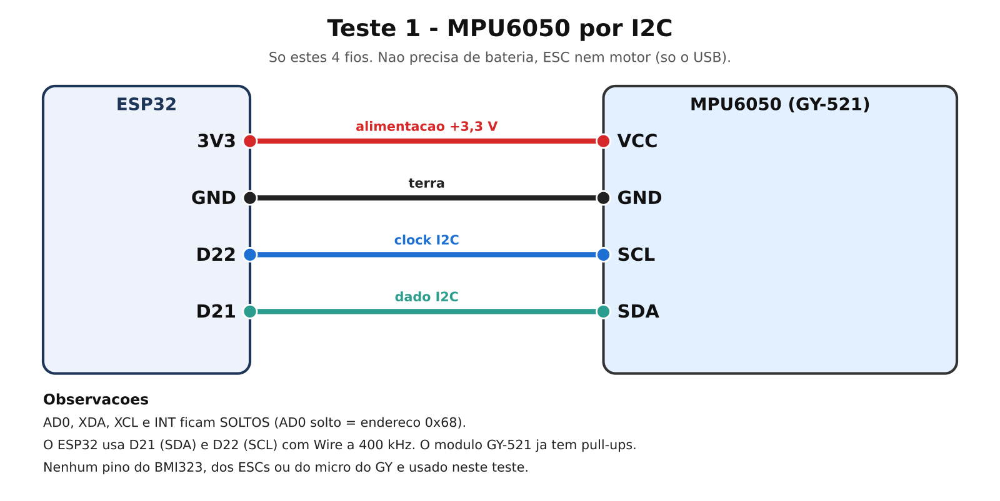

Teste 1 — MPU6050 (GY-521) por I2C
==================================

Arquivo: `teste_1_mpu6050_i2c.ino` · ESP32 · Monitor Serial **115200**.

O que o teste faz
-----------------

Confere se o MPU6050 está ligado certo e entregando sinal bom, em 4 etapas (cada uma imprime `[ OK ]` ou `[FALHOU]`):

1.  **Barramento I2C:** varre os endereços 1–126 em D21/D22 e verifica se o MPU responde em **0x68**.
2.  **Identidade:** lê `WHO_AM_I` (0x75). O MPU6050 original devolve **0x68** (clones: 0x70, 0x72, 0x98 também passam, com aviso).
3.  **Parado + calibração (~2 s):** 400 amostras com a viga **parada e nivelada** → gravidade, ruído e bias do giroscópio, e o "zero" de roll/pitch.
4.  **Ao vivo:** imprime roll, pitch e giro já descontando os offsets da calibração. Incline a viga e veja os valores mudarem.

Ligação (somente os pinos deste teste)
--------------------------------------

ESP32

MPU6050 (GY-521)

Função

**3V3**

**VCC**

alimentação 3,3 V

**GND**

**GND**

terra

**D22**

**SCL**

clock I2C

**D21**

**SDA**

dado I2C

*   **AD0, XDA, XCL, INT: soltos** (AD0 solto = endereço 0x68).
*   **Não precisa de bateria, ESCs nem motores.** Só o USB.
*   Nenhum pino do BMI323, do GY-601N1 ou dos ESCs é usado.

Como rodar
----------

1.  Arduino IDE → placa **ESP32 Dev Module** → porta COM do ESP32 (biblioteca `Wire` já vem com o núcleo ESP32).
2.  Abra `teste_1_mpu6050_i2c.ino` e faça **Upload**.
3.  Abra o Monitor Serial a **115200**.
4.  **Não encoste na viga** durante a Etapa 3 (calibração). Depois, na Etapa 4, incline a viga à vontade.
5.  `r` + ENTER repete o teste (reinicia o ESP32).

O que esperar
-------------

Etapa

Esperado

1

`encontrado no endereco 0x68` e `[ OK ] MPU6050 responde em 0x68`

2

`WHO_AM_I = 0x68` e `[ OK ] chip reconhecido`

3

amostras válidas = 400; gravidade entre **0,95 e 1,05 g**; ruído do giro **< 0,5 °/s**; bias residual **< 0,2 °/s**

3 (saída)

linha `RESUMO_CSV,MPU6050_I2C,g,rAx,rAy,rAz,bGx,bGy,bGz,rGx,rGy,rGz,temp` (para comparar com os outros testes)

4

linhas `roll:… pitch:… giroX:… giroY:… giroZ:…` ≈ 0 com a viga parada; mudam ao inclinar
