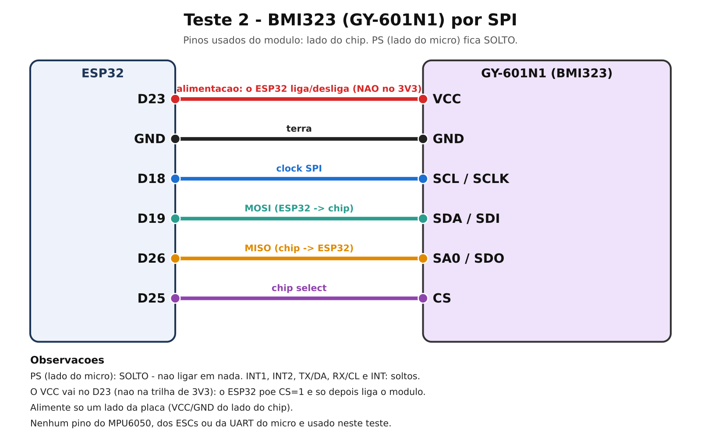

# Teste 2 — BMI323 (GY-601N1) por SPI

Arquivo: `teste_2_bmi323_spi.ino` · ESP32 · Monitor Serial **115200**.

## Ligação

| ESP32 | GY-601N1 (lado do chip) | Função |
|---|---|---|
| D23 | VCC | alimentação (o ESP32 liga/desliga o módulo; **não** vai no 3V3) |
| GND | GND | terra |
| D18 | SCL / SCLK | clock SPI |
| D19 | SDA / SDI | MOSI |
| D26 | SA0 / SDO | MISO |
| D25 | CS | chip select |

**PS (lado do micro): deixe SOLTO.** Se o PS estiver ligado, o micro da placa lê o BMI323 ao mesmo tempo e dá conflito. Os demais pinos (INT1, INT2, TX/DA, RX/CL, INT) também ficam soltos. Não precisa de bateria, ESC nem motor.

## Como rodar
1. Placa **ESP32 Dev Module**, porta COM do ESP32, abra o `.ino` e faça **Upload**.
2. Monitor Serial a **115200**, viga **parada e nivelada** durante a calibração (~4 s).
3. `r` + ENTER repete.

## O que esperar
| Etapa | Resultado |
|---|---|
| 1 | `CHIP_ID = 0x43` |
| 2 | `ACC_CONF=0x4028 GYR_CONF=0x4048 ERR=0x0000` |
| 3 | 400 amostras válidas, gravidade 0,95–1,05 g, ruído do giro < 0,5 °/s, linha `RESUMO_CSV,...` |
| 4 | `roll`, `pitch` e giro ≈ 0 com a viga parada; mudam ao inclinar |
