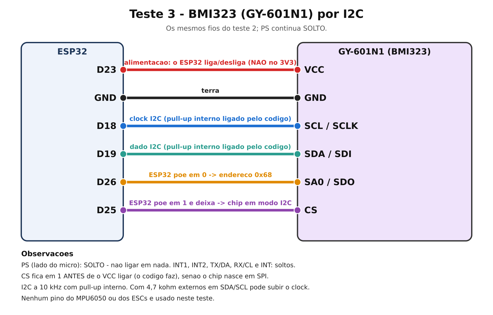

Teste 3 — BMI323 (GY-601N1) por I2C
===================================

Arquivo: `teste_3_bmi323_i2c.ino` · ESP32 · Monitor Serial **115200**.

Ligação (os mesmos fios do teste 2)
-----------------------------------

ESP32

GY-601N1 (lado do chip)

Função

D23

VCC

alimentação (o ESP32 liga/desliga o módulo; **não** vai no 3V3)

GND

GND

terra

D18

SCL / SCLK

clock I2C

D19

SDA / SDI

dado I2C

D26

SA0 / SDO

o ESP32 põe em 0 → endereço **0x68**

D25

CS

o ESP32 põe em 1 → chip em modo I2C

**PS (lado do micro): deixe SOLTO.** Se o PS estiver ligado, o micro da placa lê o BMI323 ao mesmo tempo e dá conflito. Os demais pinos (INT1, INT2, TX/DA, RX/CL, INT) também ficam soltos. Não precisa de bateria, ESC nem motor.

O código liga os pull-ups internos do ESP32 e usa I2C a 10 kHz, então não precisa de resistor externo. Com 4,7 kΩ externos (SDA e SCL → 3V3) dá para subir `I2C_HZ`.

Como rodar
----------

1.  Placa **ESP32 Dev Module**, porta COM do ESP32, abra o `.ino` e faça **Upload**.
2.  Monitor Serial a **115200**, viga **parada e nivelada** durante a calibração (~4 s).
3.  `r` + ENTER repete.

O que esperar
-------------

Etapa

Resultado

0

varreduras com `0x68` nas 3 vezes e `>>> BMI323 OK`

1

`CHIP_ID = 0x43`

2

`ACC_CONF=0x4028 GYR_CONF=0x4048 ERR=0x0000`

3

400 amostras válidas, gravidade 0,95–1,05 g, ruído do giro < 0,5 °/s, linha `RESUMO_CSV,...`

4

`roll`, `pitch` e giro ≈ 0 com a viga parada; mudam ao inclinar