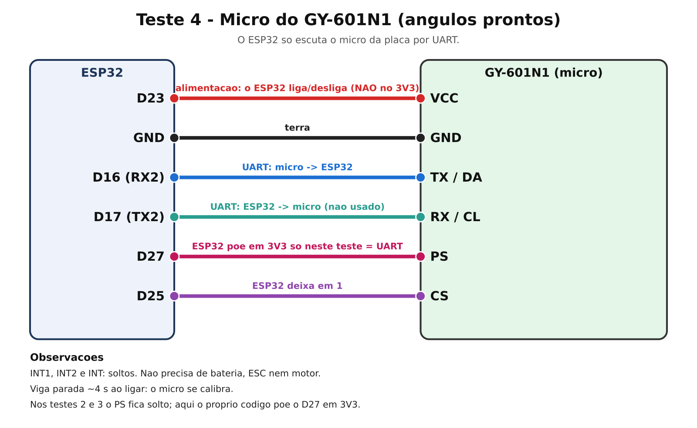

# Teste 4 — Micro do GY-601N1 (ângulos prontos)

Arquivo: `teste_4_gy601n1_mcu.ino` · ESP32 · Monitor Serial **115200**.

O micro da placa lê o BMI323, faz o filtro e manda roll, pitch, yaw e temperatura por UART. O ESP32 só escuta e mostra.

## Ligação

| ESP32 | GY-601N1 | Função |
|---|---|---|
| D23 | VCC | alimentação (o ESP32 liga/desliga o módulo; **não** vai no 3V3) |
| GND | GND | terra |
| D16 | TX / DA | UART: micro → ESP32 |
| D17 | RX / CL | UART: ESP32 → micro (ligado, não usado) |
| D27 | PS | o ESP32 põe em 3V3 só neste teste = modo UART |
| D25 | CS | o ESP32 deixa em 1 |

Fica **solto**: INT1, INT2, INT. Nos testes do BMI bruto (2 e 3) o **PS deve ficar solto** para não dar conflito; neste teste o código usa o D27 para ligá-lo em 3V3, então pode deixar o fio no D27 (nos outros testes o D27 fica como entrada). Não precisa de bateria, ESC nem motor.

## Como rodar
1. Placa **ESP32 Dev Module**, porta COM do ESP32, abra o `.ino` e faça **Upload**.
2. Monitor Serial a **115200**. Deixe a viga **parada** ~4 s: o micro se calibra ao ligar.
3. `r` + ENTER repete.

## O que esperar
| Etapa | Resultado |
|---|---|
| 1 | ~250 quadros válidos em 5 s (50/s), checksum errado ≈ 0, `[ OK ] micro do GY responde` |
| 2 | linhas `roll:… pitch:… yaw:… temp:…` ~10 por segundo; roll e pitch ≈ 0 com a viga nivelada, mudam ao inclinar |
