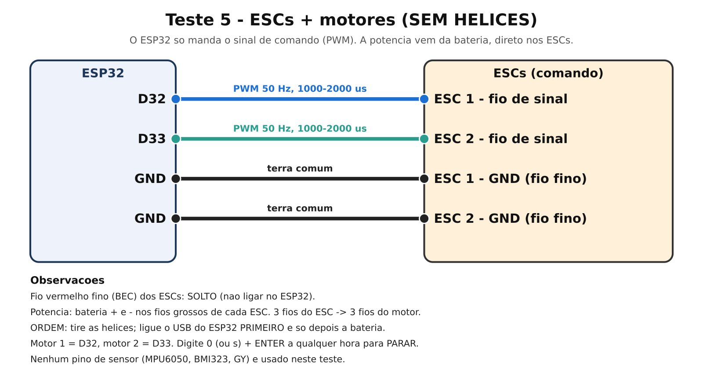

Teste 5 — ESCs + motores (SEM HÉLICES)
======================================

Arquivo: `teste_5_motores_esc.ino` · ESP32 · Monitor Serial **115200**, fim de linha **"Nova linha"**.

O que o teste faz
-----------------

*   Manda sinal PWM de 50 Hz (pulso de 1000 a 2000 µs) para os dois ESCs.
*   Deixa você ligar o motor 1, o motor 2 ou os dois, subir/descer a velocidade e **parar** a qualquer hora.
*   Calibra a **faixa** dos ESCs (1000–2000 µs) e acha o **pulso de partida** de cada motor (para igualar os dois no PID).
*   Serve também para conferir **qual motor está em qual lado** e o **sentido de giro**.

Ligação (somente os pinos deste teste)
--------------------------------------

ESP32

Vai em

Função

**D32**

fio de **sinal** do **ESC 1**

PWM do motor 1

**D33**

fio de **sinal** do **ESC 2**

PWM do motor 2

**GND**

fio **GND (fino)** do ESC 1 e do ESC 2

terra comum (obrigatório)

*   **Fio vermelho fino (BEC) dos ESCs: solto.** Não liga no ESP32.
*   **Potência:** bateria **+** e **−** nos fios **grossos** de entrada de cada ESC. Os 3 fios de saída de cada ESC vão nos 3 fios do motor.
*   **Nenhum** pino de sensor (MPU6050, BMI323, GY-601N1) é usado neste teste.

Preparação
----------

1.  Arduino IDE → placa **ESP32 Dev Module** → porta COM do ESP32.
2.  Instale a biblioteca **ESP32Servo** (Gerenciador de Bibliotecas).
3.  Abra `teste_5_motores_esc.ino`, clique em **Upload**.
4.  Abra o Monitor Serial: **115200 baud**, **Nova linha**.

Como usar (comandos no Monitor Serial)
--------------------------------------

Tecla + ENTER

O que faz

`1`

liga **só** o motor 1 (D32)

`2`

liga **só** o motor 2 (D33)

`3`

liga os **dois**

`0` ou `s`

**PARA tudo**

`+` / `-`

sobe / desce a velocidade de teste (passo de 10 µs; mín. 1040, máx. 1300; começa em 1120)

`i`

mostra o status (velocidade, motores ligados, pulsos de partida)

`x`

**calibra a faixa dos ESCs** (veja abaixo)

`p`

**calibra a partida**: sobe o pulso devagar em **um motor por vez**

`e`

sequência automática: motor 1 por 3 s, pausa de 2 s, motor 2 por 3 s

### Passo a passo

1.  Ligue o USB. O código "arma" os ESCs: manda **1000 µs por 3 s** e imprime `PRONTO` e o menu.
2.  Ligue a **bateria**. Os ESCs devem apitar (confirmação de armação).
3.  **Sentido e lado:** digite `e`. O motor 1 gira 3 s, depois o motor 2. Anote qual lado da viga girou e o sentido.

*   Girou o motor errado? Troque os fios de sinal D32 ↔ D33.
*   Sentido errado? Troque **2 dos 3 fios** entre o ESC e o motor.

1.  **Velocidade:** `1`, depois `+` algumas vezes (cada `+` = +10 µs). `0` para parar.
2.  **Calibrar faixa (`x`)** — só se os ESCs não estiverem na faixa 1000–2000:
3.  **Desligue a bateria**, deixe só o USB.
4.  Digite `x`: o código manda **2000 µs (máximo)** aos dois ESCs.
5.  **Ligue a bateria** e espere os bipes.
6.  Depois dos bipes digite **`n`**: o código manda 1000 µs (mínimo) e espera 3 s. Fim dos bipes = calibrado.
7.  **Calibrar partida (`p`):**
8.  O código sobe o pulso de 1040 µs em passos de **5 µs a cada 0,4 s** no motor 1 e imprime `pulso:NNNN`.
9.  Aperte **ENTER** assim que o motor **começar a girar** (ou `0` para abortar).
10.  Repete para o motor 2.
11.  Imprime `PARTIDA_CSV,<motor1>,<motor2>` e a diferença. Se a diferença passar de **~20 µs**, rode `x` e repita.

O que esperar / critérios
-------------------------

Item

Esperado

Armação

`PRONTO.` após 3 s; bipes dos ESCs ao ligar a bateria

`e`

cada motor gira 3 s, um de cada vez

`p`

`>> MOTOR n começou a girar em XXXX us` para os dois; diferença pequena (< ~20 µs)

Parada

`0` sempre responde com `>> PARADO (1000 us)`